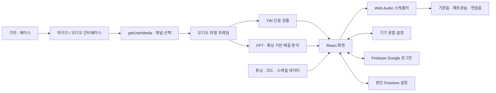

# 아키텍처

## 실행 구조

React·TypeScript 앱을 Vite로 정적 빌드하여 Firebase Hosting에서 제공합니다. 음악 분석과 소리 생성은 클라이언트에서 수행하므로 별도의 오디오 처리 서버나 Cloud Function은 필요하지 않습니다.



오디오 파형은 Firebase로 보내지 않습니다. 네트워크가 필요한 경로는 Google 인증, 계정 설정 저장, 외부 악보 출처입니다.

## 오디오 입력과 튜너

`TunerAudio`는 입력 시작·중지, 장치와 채널, 오디오 그래프를 관리합니다. 입력은 스피커에 연결하지 않습니다. UI는 프레임을 받아 현재 모드에 따라 검출기를 호출합니다.

- 단음 검출: 파형의 주기성을 YIN 방식으로 분석합니다.
- 폴리 검출: 현재 튜닝의 목표 개방현을 알고 있다는 조건에서 FFT의 기본음·배음 증거를 비교합니다.
- 레벨 또는 신뢰도가 충분하지 않으면 검출 결과를 반환하지 않습니다.
- 목표 튜닝을 바꾸면 각 현의 목표 주파수와 지판 음이 함께 달라집니다.
- 기준 주파수 A4는 MIDI ↔ 주파수 변환에 적용됩니다.

이것은 음원을 일반적으로 채보하는 모델이 아닙니다. 한 입력 채널에서 겹치는 배음은 근본적인 모호성이 있으므로 실험 폴리 기능과 단음 확인을 함께 제공합니다. 자세한 신호 처리·분석 창·한계는 [튜너 설계](audio-research.md)를 참고하세요.

## 음악 데이터와 표시

튜닝 데이터는 **가장 낮은 현부터 높은 현 순서의 MIDI 음높이**로 저장합니다. 프렛은 개방현 MIDI에 프렛 번호를 더해 계산합니다. 뮤트된 현의 보이싱 프렛 값은 `-1`입니다.

스케일과 코드 품질은 근음 기준 반음 간격으로 정의합니다. 음높이 계산과 표시를 분리하여 같은 데이터가 다른 튜닝·근음에서도 동작하도록 합니다. 보이싱은 유효한 구성음·프렛 범위를 탐색하고 가까운 운지를 우선합니다. 모든 사람에게 편한 운지를 보장하는 생체역학 모델은 아닙니다.

재즈 자료는 곡 메타데이터·연습용 진행·포함된 악보·외부 출처의 성격을 구분합니다. 원곡의 출판 악보가 외부에 있는 경우 정식 제공업체로 연결합니다. 원본 연습 악보는 ABC 표기로 정의하고 abcjs로 오선에 렌더링합니다.

## 메트로놈과 오디오 재생

소리의 실제 시간 기준은 JavaScript 화면 타이머가 아닌 `AudioContext.currentTime`입니다. 스케줄러가 가까운 미래의 클릭을 미리 예약하고 화면은 현재 박을 표시합니다. 박자·세분박·강세·스윙·카운트인·점진 속도 설정이 예약할 이벤트에 반영됩니다.

브라우저가 백그라운드 탭을 중단하거나 오디오 장치를 바꾸면 재생이 영향을 받을 수 있습니다. 재생을 중지하면 예약 상태와 오디오 리소스를 정리합니다. 튜닝 중 스피커에서 나는 클릭이 입력에 섞일 수 있으므로 헤드폰 사용이 유리합니다.

## 인증과 계정 설정

`src/lib/firebase.ts`에서 Firebase 앱과 Auth·Firestore 인스턴스를 초기화합니다. Google 로그인은 클릭에서 직접 `signInWithPopup`을 호출합니다. Firebase가 로그인 상태를 지속하고 `onAuthStateChanged`가 화면에 반영합니다.

사용자 설정 경로는 `users/{uid}/preferences/main`입니다.

```text
schemaVersion: 1
settings: { ...연습 설정... }
updatedAt: serverTimestamp()
```

클라이언트는 현재 UID만 요청하도록 확인하고 Firestore 규칙이 동일 조건을 서버에서 강제합니다. 본인 문서의 직접 조회만 허용하며 컬렉션 목록·다른 사용자·다른 경로는 거부합니다. 설정 맵은 전체 교체하여 삭제한 즐겨찾기가 남는 일을 피합니다.

계정별 로컬 캐시를 사용하여 계정 전환 시 이전 사용자의 설정이 다음 계정으로 자동 저장되지 않도록 합니다. 클라우드 실패는 사용자에게 알리고 로컬 연습을 계속할 수 있습니다. Firebase 최초 설정과 오류 코드는 [Firebase 문서](firebase-setup.md)에 정리했습니다.

## 빌드와 검증

- TypeScript가 모듈 연결과 타입을 검사합니다.
- Node 테스트가 합성 파형의 음높이, 튜닝·이론 계산, 메트로놈 예약 로직을 검사합니다.
- Vite가 프로덕션 번들을 생성합니다.
- Firebase CLI가 Firestore 규칙을 컴파일하고 배포합니다.
- GitHub Actions가 `npm ci`, `npm test`, `npm run build`를 반복합니다.

실제 마이크·오디오 인터페이스, 스피커 지연, 브라우저 권한, Google OAuth 화면은 단위 테스트로 검증되지 않습니다. 브라우저 제어가 비활성화된 개발 환경에서는 HTTP 응답·정적 빌드 검증까지만 수행하고 그 한계를 명시합니다.

### 의존성 점검

2026-11-18 기준 `npm audit --omit=dev`는 알려진 취약점 0건을 반환했습니다. Firebase의 Node 경로가 참조하는 `@grpc/grpc-js`는 `1.14.7`로 고정하여 유지관리자의 [인증서 처리](https://github.com/grpc/grpc-node/security/advisories/GHSA-m9gg-hp2v-232j) 및 [서버 오류 메시지 노출](https://github.com/grpc/grpc-node/security/advisories/GHSA-f596-whhp-79r4) 수정 버전을 사용합니다. 이 앱의 브라우저 Firestore는 웹 전송을 사용합니다.

개발 의존성을 포함한 감사에는 `picomatch@4.0.7`의 [반복 extglob ReDoS 권고](https://github.com/advisories/GHSA-fc5q-39xc-vjpf)가 Vite·tinyglobby·fdir로 전파되어 5건으로 표시됩니다. 현재 설치 가능한 최신 버전에 수정이 없어 빌드 도구를 과거 메이저로 강제 다운그레이드하지 않았습니다. 이 경로는 프로덕션 정적 번들에 포함되지 않습니다. 유지관리자가 수정 버전을 배포하면 lockfile을 갱신하고 감사·빌드를 다시 확인해야 합니다.
