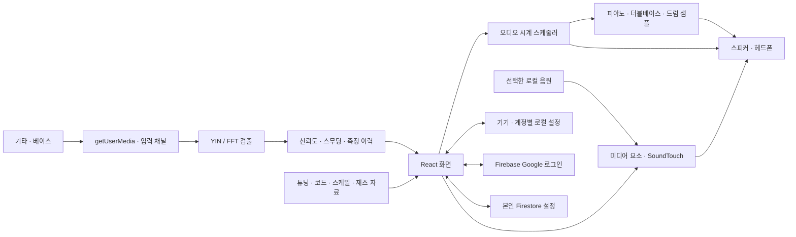

# 아키텍처

## 실행 구조

React·TypeScript 앱을 Vite로 정적 빌드하여 Firebase Hosting에서 제공합니다. 튜닝 분석, 악보 렌더링, 녹음 샘플 반주와 로컬 음원 처리는 브라우저에서 수행합니다. 별도의 오디오 처리 서버나 Cloud Function은 없습니다.



마이크 파형과 사용자가 선택한 음원 파일은 Firebase로 보내지 않습니다. 로그인·계정 설정·정적 모듈·자체 호스팅 악기 샘플 로딩·외부 악보 출처에는 네트워크 연결이 필요합니다.

## 화면과 모듈 경계

| 모듈                                           | 책임                                               |
| ---------------------------------------------- | -------------------------------------------------- |
| `App.tsx`                                      | 화면 전환, 인증 상태, 설정 동기화, 전역 단축키     |
| `TunerView.tsx`                                | 입력·채널, 튜닝 선택, 단음·동시 표시, 기준음       |
| `MetronomeView.tsx`                            | 템포·박자·강세·세분박·리듬 프리셋                  |
| `MusicViews.tsx`                               | 코드·스케일 지판, 재즈 차트·악보·외부 자료         |
| `JazzPractice.tsx`                             | 샘플 반주와 로컬 파일의 재생·키·반복·믹서 조작     |
| `lib/audio.ts`, `pitch.ts`, `pitch-tracker.ts` | 입력 수명, 검출, 시간에 따른 표시 안정화           |
| `lib/theory.ts`, `jazz.ts`                     | 음악 계산, 코드 파싱·전조, 마디·박자 해석          |
| `lib/backing.ts`                               | 반주 음표·리듬·보이싱 계획과 오디오 시계 예약      |
| `lib/instruments.ts`                           | 자체 호스팅 녹음 샘플·코덱 대체·캐시·악기별 렌더링 |
| `lib/metronome.ts`, `synth.ts`                 | 메트로놈 클릭과 코드·스케일 연습음                 |
| `lib/track.ts`                                 | 미디어 시계·SoundTouch·탐색·A–B 반복·파일 해제     |
| `lib/firebase.ts`                              | Google 인증과 본인 설정 읽기·쓰기                  |

## 오디오 입력과 튜너

`TunerAudio`는 `getUserMedia`, 입력 장치, L/R 분리, 레벨·피크, 오디오 그래프를 관리합니다. 입력은 스피커에 연결하지 않습니다. 프레임은 현재 모드의 검출기에 전달하고, `PitchTracker`가 검출 신뢰도·지속성·로그 주파수 스무딩을 적용합니다.

- 단음은 최근 16384샘플의 주기성을 YIN 방식으로 분석합니다. 작은 감쇠음은 RMS 0.00015까지 검출 후보로 허용하되 더 강한 주기성 검사를 적용합니다.
- 폴리는 현재 튜닝의 개방현 목표를 전제로 32768점 FFT의 기본음·배음 증거를 비교합니다.
- 짧은 끊김에서 단음은 최대 720ms, 폴리는 현별 최대 650ms까지 **과거 측정값**을 유지합니다. 유지된 결과는 흐리게 표시하며 현재의 녹색 정음 판정을 하지 않습니다.
- 튜닝·A4·모드 변경과 입력 종료 시 추적 이력을 지웁니다.
- 튜너는 탭 이동이나 로그인 전환에도 마운트를 유지하며 입력을 계속합니다. 숨겨진 화면에서는 분석을 약 4Hz로 줄입니다. 기기·채널 변경은 새 입력으로 자동 연결하고, 정지 버튼과 페이지 종료 시 트랙·컨텍스트를 해제합니다. 취소된 연결 요청이 늦게 완료되어도 입력을 다시 켜지 않습니다.

이는 일반적인 다중 음원 채보 모델이 아닙니다. 한 채널에서 겹치는 배음 때문에 일부 현을 구분하기 어려울 수 있습니다. 분석 창·감쇠음 대응·실기기 한계는 [튜너 설계](audio-research.md)를 참고하세요.

## 음악 데이터와 악보

튜닝은 가장 낮은 현부터 높은 현 순서의 MIDI 음높이로 저장합니다. 프렛은 개방현 MIDI에 번호를 더하고, 뮤트된 현은 `-1`로 표시합니다. 코드·스케일은 근음 기준 반음 간격으로 정의하여 튜닝과 근음이 바뀌어도 같은 계산을 사용합니다. 보이싱 탐색은 유효 구성음과 프렛 범위를 제한하지만 실제 손의 운지 가능성까지 보장하지 않습니다.

재즈 자료는 메타데이터·연습용 진행·내장 악보·외부 출처를 구분합니다. 오리지널 연습곡과 전통 선율의 ABC 표기는 `abcjs`로 렌더링합니다. 상업용 멜로디 출판 악보는 정식 제공업체로 연결합니다. `jazz.ts`는 코드 종류·텐션·슬래시 베이스를 파싱하며, 모르는 기호를 메이저로 추정하지 않습니다.

## 메트로놈과 샘플 반주

시간 기준은 `AudioContext.currentTime`입니다. 스케줄러가 가까운 미래의 소리를 예약하고 별도 콜백이 박·마디를 표시합니다. 중지하면 예약된 화면 콜백·소스·노드를 정리합니다. 백그라운드 중단 뒤 놓친 소리를 한 번에 예약하지 않습니다.

`JazzBacking`은 코드 마디를 피아노·베이스·드럼 이벤트로 계획하고 `JazzInstruments`가 실제 악기 녹음을 재생합니다. 피아노는 두 벨로시티 녹음 층, 베이스는 두 변주를 사용하며 음마다 가까운 녹음 루트에서 전조합니다. 악기별 버스와 마스터 컴프레서를 거칩니다. 한 마디의 여러 코드는 분수 박 경계도 유지합니다. 템포·키·레벨은 다음 예약부터, 패턴·박자·폼 변경은 다음 마디에 반영됩니다. 마디 반복, 카운트인, 코러스, 유한 재생 종료를 지원합니다. [반주 엔진](backing.md)

샘플 40개를 M4A·OGG 두 형식으로 직접 제공하며 전체 약 5.29MB, 기본 M4A 첫 다운로드는 2,778,918바이트(약 2.8MB)입니다. 반주를 처음 시작할 때 5개씩 읽고 디코딩한 뒤 재생합니다. 압축 바이트와 준비된 PCM은 재사용하며 준비 중 취소·25초 전체 제한·실패 오류를 지원합니다. 샘플 준비가 실패하면 이전 합성음으로 대체하지 않습니다.

`/samples/jazz-v1/**`는 버전이 포함된 불변 URL이며 Hosting이 `public,max-age=31536000,immutable`로 제공합니다. 해당 버전의 바이트를 바꾸지 않고, 샘플을 갱신할 때는 `jazz-v2`처럼 새 경로와 렌더러 URL을 함께 배포해야 합니다. 출처 고지·라이선스·해시 manifest도 샘플과 함께 보관합니다.

## 내 음원 재생

`LocalTrack`은 파일을 object URL로 연결한 `HTMLAudioElement`에서 읽습니다. 전체 음원을 먼저 메모리에 디코딩하지 않고 미디어 요소의 시계를 재생 위치로 사용합니다. Web Audio 경로에서는 SoundTouch의 속도 보정과 반음 이동을 적용합니다. 미지원 환경은 키 변경을 끄고 네이티브 속도 재생으로 돌아가며, 실행 중 DSP 오류는 재생을 중단하고 알립니다.

A–B 반복은 원본 파일의 초 단위 위치를 사용합니다. 탐색할 때 처리 버퍼를 버리고, 파일 교체·해제 시 이전 로드와 재생 요청·노드·포트·object URL을 정리합니다. A–B 경계는 샘플 단위 반복이 아니므로 전면 탭에서 사용하는 것이 좋습니다. [로컬 음원 설계](audio-playback.md)

## 인증과 계정 설정

`firebase.ts`는 Firebase 앱과 Auth를 초기화합니다. Google 로그인은 클릭에서 `signInWithPopup`을 호출하고, `onAuthStateChanged`가 지속된 계정 상태를 화면에 전달합니다. Firestore 모듈과 인스턴스는 로그인 계정의 설정 호출에서 처음 동적으로 읽습니다.

설정 경로는 `users/{uid}/preferences/main`입니다.

```text
schemaVersion: 1
settings: { ...연습 설정... }
updatedAt: serverTimestamp()
```

클라이언트가 호출 전·비동기 조회 후 UID를 다시 확인하고, Firestore 규칙도 본인 문서만 허용합니다. 컬렉션 목록·다른 계정·다른 경로는 거부합니다. 설정 맵을 전체 교체하여 삭제한 즐겨찾기가 남지 않게 합니다. 계정별 로컬 캐시는 다른 계정의 설정이 자동 저장되는 일을 방지합니다. 파일 내용과 파일 접근 권한은 클라우드 설정에 저장하지 않습니다. [Firebase 구성](firebase-setup.md)

## 지연 로딩과 번들

- `App.tsx`는 코드·스케일·재즈 화면을 `React.lazy`로 읽습니다.
- `abcjs`는 실제 오선 악보를 렌더링할 때 동적으로 가져옵니다.
- SoundTouch 모듈과 프로세서는 로컬 음원을 준비할 때 가져옵니다. 미지원 환경에서 모듈 평가 자체가 앱 시작을 막지 않도록 분리했습니다.
- 비로그인 연습은 Firestore 클라이언트를 로드하지 않습니다.
- 악기 녹음 파일은 재즈 반주를 처음 시작할 때만 읽으며 다른 도구 진입에는 추가하지 않습니다.

현재 프로덕션 빌드에서 초기 JS는 약 **851KB → 395KB**, 약 **54% 감소**했습니다. 음악 화면 청크는 약 **541KB → 70KB**로 나누었고, ABC 렌더러 약 **509KB**는 별도 지연 청크입니다. 모두 압축 전 초기 진입·청크 크기이며 실제 전송량은 압축·캐시·열어본 화면에 따라 달라집니다.

## 검증과 남은 실기기 확인

자동 테스트 **51개**는 음높이·감쇠음 추적, 음악 이론과 코드 파싱, 오디오 예약·반복·카운트인·취소, 로컬 파일의 미디어 시계와 자원 수명, 녹음 샘플 파일의 해시·파라미터·코덱 대체·취소·캐시 재사용을 검사합니다. TypeScript와 Vite가 모듈·타입·프로덕션 빌드를 확인하고, GitHub Actions가 설치·테스트·빌드를 실행합니다.

실제 브라우저의 **390px 화면**에서 반주 재생 경로, 템포·키 변경과 차트 하이라이트를 확인했습니다. 생성한 로컬 WAV의 **0.75배 / −1반음 재생**, **3–6초 A–B 반복**, 일시 정지를 확인했고 해당 점검 중 콘솔 경고·오류는 없었습니다. 실제 샘플 렌더러·연주 계획의 16마디 WAV를 별도로 생성해 피크·RMS·음역을 수치로 점검합니다. 사람이 청취하여 음질을 승인한 검증은 아닙니다.

최종 샘플 반주 렌더에서 기본 16마디 피크 0.2795·RMS 0.0240, 최대 레벨·키·템포 스트레스의 최댓값 피크 0.758로 디지털 클리핑이 없었습니다. 베이스는 모든 키 이동 후 MIDI 28–47로 제한합니다. [반주 검증 세부 수치](backing.md#검증과-출처)

이 점검은 실제 휴대폰 마이크의 기타 감쇠음, 악기·인터페이스의 튜닝 정확도, 모바일 코덱·출력 지연, 사용자 Google 계정의 로그인 전체 흐름까지 검증한 것은 아닙니다. 해당 부분은 실기기 확인이 남아 있습니다.

## 의존성과 고지

SoundTouchJS 2.1.1 관련 패키지는 원본을 수정하지 않고 사용하며, MPL-2.0 전문·패키지 고지·정확한 릴리스 소스 안내를 `public/`에 포함합니다. [배포 고지](../public/third-party-notices.txt)와 [로컬 음원 라이선스 설명](audio-playback.md#오픈소스-고지)을 참고하세요.

악기 샘플은 Splendid AKAI 공개 도메인 녹음, D. Smolken과 menegass의 CC0 녹음입니다. [샘플 고지](../public/samples/jazz-v1/NOTICE.txt), 버전별 manifest와 CC0 전문을 함께 배포합니다. smplr의 샘플 배포 설계를 조사했으며 이 앱은 별도 smplr 런타임 의존성을 추가하지 않은 작은 네이티브 샘플러를 사용합니다.

`@grpc/grpc-js`는 `package.json`의 override로 1.14.7을 사용합니다. 의존성 변경 후에는 `npm audit --omit=dev`와 개발 도구를 포함한 `npm audit` 결과를 각각 검토하세요. 감사 결과는 실행 시점의 설치 버전과 공개 권고 데이터에 따라 달라지며 빌드·기능 검증과 별도로 관리합니다.
